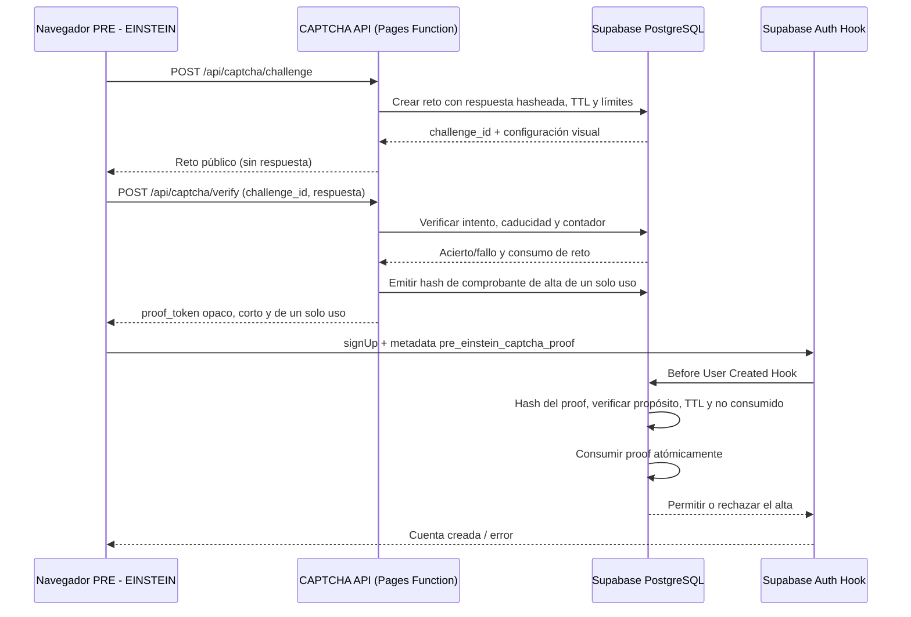

# PRE - EINSTEIN Verify · CAPTCHA propio

> Estado: arquitectura objetivo. No está implementado ni activado en producción. La interfaz actual todavía contiene integración de Cloudflare Turnstile; esta especificación define su reemplazo por un verificador propio.

## Objetivo

Diseñar un desafío CAPTCHA de primera parte, producido por PRE - EINSTEIN, sin hCaptcha, Turnstile ni Google reCAPTCHA. La validación debe ocurrir en servidor y también ser obligatoria al crear usuarios directamente contra Supabase Auth.

Un acertijo validado exclusivamente en JavaScript no es un control anti-bot: basta inspeccionar el bundle o llamar a Supabase directamente para omitirlo. El sistema propio no promete identificar personas ni ser imposible de automatizar; aumenta el coste de automatización junto con límites de frecuencia, tokens de un solo uso y controles de abuso.

## Arquitectura elegida

- Cliente: aplicación Vite. Renderiza el reto visual propio y captura la selección.
- Motor PoW: `altcha` (widget Web Component) y `altcha-lib` (generación/verificación server-side), ambos del núcleo open-source MIT. Se ejecutan en nuestra infraestructura; no se usa ALTCHA Cloud ni Sentinel.
- Backend de reto: Supabase Edge Functions `captcha-challenge` y `captcha-verify`, usando `altcha-lib` compatible con Deno 2+. Nunca confía en una respuesta enviada por el navegador sin verificarla criptográficamente.
- Persistencia: PostgreSQL de Supabase, tablas internas de CAPTCHA con RLS y sin permisos para `anon` ni `authenticated`. Se registra el nonce/reto y el consumo para impedir replays; los secretos viven solo en Edge Function Secrets.
- Barrera de alta: Supabase Auth **Before User Created Hook**. El hook comprueba y consume de forma atómica el comprobante antes de que Supabase inserte la nueva cuenta.

Supabase documenta el hook Before User Created como punto de control previo al alta; recibe metadatos de la solicitud (incluida IP y request ID) y el usuario que está por crearse. Puede permitir con objeto vacío o rechazar con error 4xx. Referencias: [hook](https://supabase.com/docs/guides/auth/auth-hooks/before-user-created-hook), [Auth Hooks](https://supabase.com/docs/guides/auth/auth-hooks).

## Flujo completo

## Diseño del desafío

### Reto base

Usar ALTCHA Proof-of-Work en modo autohospedado: el servidor crea un reto nuevo, firmado y con expiración; el navegador resuelve el trabajo criptográfico y devuelve el payload. `altcha-lib` valida firma, expiración y solución en servidor. No se envían imágenes ni se obliga al alumno a resolver acertijos visuales.

La presentación se personaliza para PRE - EINSTEIN mediante el Web Component `altcha-widget`, tema CSS propio, textos en español y estilos del sistema de diseño. El usuario debe ver un estado claro: pendiente, verificando, verificado, vencido o error. La accesibilidad del widget y el idioma se deben comprobar en dispositivos móviles reales.

El motor PoW no identifica personas ni detiene por sí solo automatizaciones avanzadas. Se combina con rate limits, nonce de un solo uso, límites de registro y confirmación de correo.

### Defensa en profundidad

- Nonce criptográficamente aleatorio; no usar `Math.random()` para secretos.
- Respuestas normalizadas y hash con salt aleatorio; no guardar respuesta en claro.
- Challenge TTL configurable, por defecto 3 minutos.
- Máximo configurable de intentos por challenge; tras excederlo, invalidar.
- Comprobante opaco con propósito `signup`, expiración de 2–3 minutos y un solo uso.
- Almacenar solo el hash del comprobante, nunca el token original.
- Consumo atómico: UPDATE condicionado por hash, propósito, expiración y `consumed_at IS NULL`; solo una solicitud puede consumirlo.
- Límites por IP seudonimizada (HMAC con secreto rotatorio) y ventana temporal; no guardar IP sin necesidad.
- Honeypot invisible para usuarios, comprobación de campos inesperados y umbral mínimo razonable entre emitir y verificar.
- Rate limit para emisión, verificación y altas; mensajes no deben revelar si un correo existe.
- Logs sin contraseña, respuesta del reto, token ni PII innecesaria.
- Limpieza programada de retos caducados y eventos antiguos.
- Protección CSRF/origin y CORS restringido a los dominios de la academia.
- No aceptar IP indicada por el usuario. Obtener la IP únicamente de los encabezados confiables que Pages/Cloudflare añade en el borde.

Estos controles encarecen la automatización, pero no sustituyen rate limiting, verificación por email, monitorización y respuesta a abuso.

## Modelo de persistencia propuesto

Las siguientes tablas deben residir en un esquema interno/no expuesto o tener RLS, grants y políticas explícitas de acceso de servidor únicamente:

### `captcha_challenges`
- `id` UUID/ULID aleatorio (PK).
- `purpose` enum: `signup`, `password_reset` (habilitar solo cuando se implemente).
- `challenge_payload` JSONB público: instrucción y símbolos, sin clave.
- `answer_hash` TEXT (hash de respuesta + salt).
- `answer_salt` TEXT aleatorio.
- `attempt_count` INTEGER.
- `max_attempts` INTEGER.
- `ip_fingerprint` TEXT HMAC, nullable.
- `created_at`, `expires_at`, `consumed_at`.

### `captcha_proofs`
- `id` UUID.
- `proof_hash` TEXT UNIQUE.
- `purpose` enum, `expires_at`, `consumed_at`, `created_at`.
- Nunca guardar email, contraseña, token original ni user_id antes del alta.

### `captcha_rate_limits`
- `scope`, `subject_fingerprint`, `window_started_at`, `counter`, `updated_at`.
- UPSERT transaccional y límites separados para issue, verify y signup.
- El fingerprint se genera con HMAC y secreto rotatorio; nunca con IP cruda.

## Contrato API

### POST `/functions/v1/captcha-challenge`
Emite un reto ALTCHA firmado para el propósito `signup`, con expiración corta y nonce aleatorio. Responde con el objeto `challenge` esperado por el widget. No devuelve secretos de firma.

### POST `/functions/v1/captcha-verify`
Recibe el payload ALTCHA. Ejecuta `verifySolution` en servidor con `altcha-lib`, valida el propósito y la expiración, y consume el nonce de forma atómica. Solo si todo es válido emite un comprobante opaco de alta, guardando únicamente su hash.

Errores: `400` payload inválido, `409` reto ya usado, `429` límite excedido, `410` expirado, `503` servicio temporalmente no disponible. No entregar comprobantes en caso de error.

## Integración con Supabase Auth

El formulario envía el proof como metadata de solicitud:
`options.data.pre_einstein_captcha_proof = proofToken`.

El hook Before User Created:
1. Lee `user.user_metadata.pre_einstein_captcha_proof`.
2. Rechaza si falta, está malformado o excede la longitud máxima.
3. Calcula el hash y consume un único proof vigente cuyo purpose sea `signup`.
4. Si no consume exactamente una fila, retorna error 400 y detiene el registro.
5. Si tiene éxito, permite la creación.
6. Un trigger posterior elimina el campo temporal de la metadata del perfil para no conservar el proof.

El hook debe ejecutarse para cualquier alta de email y OAuth que esté habilitado; no confiar en que solo la UI de registro lo llama. El secreto de firma del hook y el secreto del backend deben almacenarse exclusivamente en Supabase/Cloudflare como secretos, nunca en el repo ni en variables `VITE_*`.

El hook oficial recibe `event.user.user_metadata` y `event.metadata.ip_address`; permite bloquear el alta con una respuesta `error` y estado 4xx. Supabase muestra cómo conceder `EXECUTE` a `supabase_auth_admin` y revocarlo de roles de cliente. Referencias: [Before User Created Hook inputs/outputs](https://supabase.com/docs/guides/auth/auth-hooks/before-user-created-hook), [Auth Hooks](https://supabase.com/docs/guides/auth/auth-hooks).

## Integración frontend

- Crear un servicio `src/core/captcha-client.js` con `createChallenge()`, `verifyChallenge()` y `resetChallenge()`.
- Componente accesible `src/ui/captcha-widget.js`; estados `loading`, `ready`, `verifying`, `verified`, `expired`, `error`.
- Desactivar “Crear cuenta” hasta que el servidor devuelva el comprobante.
- El token se mantiene solo en memoria, se consume en el intento de registro y se descarta siempre tras respuesta/error.
- Ante error del Auth Hook, pedir un nuevo reto. No reusar proofs.
- La pantalla debe continuar ofreciendo la confirmación de correo de Supabase; CAPTCHA no la reemplaza.

## Variables de entorno de servidor (nunca VITE_)

- `SUPABASE_URL`
- `SUPABASE_SERVICE_ROLE_KEY` (solo Edge Function; nunca frontend)
- `CAPTCHA_HMAC_SECRET` (mínimo 32 bytes aleatorios, solo Edge Function)
- `CAPTCHA_ALLOWED_ORIGINS`
- `BEFORE_USER_CREATED_HOOK_SECRET` en Supabase Auth Hooks, según el método de hook configurado.

No se debe implementar mientras no estén provisionados los secretos en los dos paneles. El secreto service-role no se debe imprimir, commitear ni incluir en el bundle estático.

## Plan de construcción y pruebas

1. Instalar `altcha` y `altcha-lib` con versiones fijadas; revisar licencias y lockfile.
2. Esquema/migración privada, RLS/grants, índices y limpieza de caducados.
3. Supabase Edge Functions challenge/verify con ALTCHA; validación de origin y límites transaccionales.
4. Hook Before User Created y trigger para retirar metadata temporal.
5. Widget ALTCHA personalizado en español y flujo de alta; eliminar dependencia de Turnstile.
6. Pruebas unitarias de firma, PoW, expiración y un solo uso.
7. Pruebas de integración: proof faltante, inválido, repetido, caducado, propósito equivocado, concurrencia doble, rate limit, origen no permitido, alta directa Auth que omite la interfaz, confirmación de email y rollback.
8. Pruebas E2E en Preview y Production.
9. Revisión Supabase Advisors, logs y política de retención.

## Riesgos aceptados y límites

- Un CAPTCHA propio no bloquea a todos los bots; atacantes pueden usar OCR, modelos multimodales, granjas humanas o navegadores reales.
- SVGs y retos visuales accesibles deben ser resistentes a enumeración básica, pero no “anti IA”.
- Rate limits por IP pueden afectar a redes escolares/NAT; combinar límites graduales, ventana y señales para no bloquear a todos los alumnos.
- Si el backend/hook no está disponible, fallar cerrado para nuevos registros y mostrar reintento; nunca dejar que el cliente omita el control.
